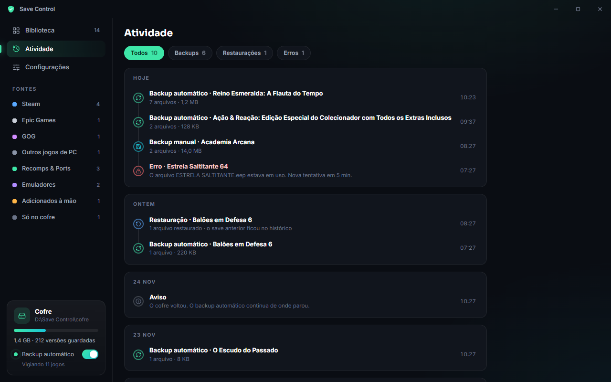

# Save Control

> Cofre de saves portátil para Windows: encontra os saves dos seus jogos, faz backup automático e restaura com segurança.


**Status:** o app já funciona: biblioteca, backup manual e automático, histórico, restauração e Atividade. Ainda não há uma versão pronta para baixar; por enquanto, é preciso [compilar](#compilar). Veja também [o que vem por aí](#o-que-vem-por-aí).

## O problema

Cada jogo guarda o save num lugar diferente: AppData, Documentos, a pasta do próprio jogo, a pasta do emulador. Na hora de atualizar um jogo, trocar de PC ou formatar, é fácil perder o progresso sem nem saber onde ele estava.

## O que ele faz

### Encontra os saves sozinho

- **Jogos de PC** (Steam, Epic, GOG e outras lojas), usando a base de locais de save do [PCGamingWiki](https://www.pcgamingwiki.com/), compilada pelo [ludusavi-manifest](https://github.com/mtkennerly/ludusavi-manifest). A base (17 MB) é baixada no primeiro uso e conferida no máximo uma vez por dia.
- **Recompilações e emuladores**, por um catálogo próprio: projetos baseados no N64Recomp (como Zelda 64: Recompiled e Banjo: Recompiled, inclusive no modo portátil), Project64 e RetroArch. Para os que ficam numa pasta sua, é só adicionar a pasta (ex.: `D:\Jogos`) em Configurações.
- **Qualquer outro jogo**, adicionado à mão: a pasta do save, o processo do jogo e uma capa, se você quiser.

### Biblioteca

- Os jogos em grade, com as capas oficiais da Steam (se você quiser) ou capas geradas, e o status de cada um: Protegido, Save novo, Sem backup ou Sem save.
- Filtros por loja e tipo, busca (Ctrl+K) e avisos úteis, como save dentro de Downloads, dentro da pasta do jogo ou sincronizado pela nuvem da loja.
- Um painel para cada jogo, com o histórico, os arquivos do save e os ajustes daquele jogo.


### Cofre portátil

- Uma pasta só, ao lado do app ou num HD externo, com o histórico de cada jogo em arquivos `.zip` comuns.
- Vários PCs podem usar o mesmo cofre; cada backup mostra de qual PC veio.
- Se o HD do cofre estiver desligado, o app avisa e nunca grava em outro lugar sem perguntar.

### Backup manual e automático

- **Backup com nome** ("antes de atualizar o recomp") quando você quiser, de um jogo ou de tudo de uma vez.
- **Backup automático** em segundo plano:
  - 10 s depois que você fecha o jogo, quando dá para saber que ele está aberto;
  - no máximo 1 a cada 15 min enquanto você joga, para proteger sessões longas;
  - depois de 60 s sem mudanças, quando não dá para saber se o jogo está aberto;
  - pausa pelo ícone da bandeja (por 30 min, 2 h ou até reabrir o app);
  - com o HD do cofre desligado, ele pausa e volta sozinho quando o HD volta.
- Notificação do Windows (opcional) com a capa do jogo e o botão "Ver histórico".
- Os tempos do automático são ajustáveis em Configurações.

### Histórico e restauração segura

- **Antes de restaurar, o save atual vira um backup.** Nada se perde.
- Restaura uma versão inteira ou só alguns arquivos.
- Os caminhos ficam guardados de forma genérica (AppData do usuário, pasta da Steam...), então a restauração funciona em outro PC, com outro usuário ou em outro disco.
- **Retenção:** dos backups automáticos, ficam os 10 mais recentes, 1 por dia por 7 dias e 1 por semana por 4 semanas, ajustável no geral e por jogo. Backups com nome e automáticos fixados (com estrela) nunca são apagados.

### Atividade

Backups, restaurações, erros e avisos, dia a dia, com filtros. Clicar numa linha abre o jogo.



### Na bandeja, sem atrapalhar

- Fechar a janela deixa o app na bandeja, vigiando os saves; a janela sai da memória até você abrir de novo.
- "Iniciar com o Windows (na bandeja)", se você quiser.

### Portátil de verdade

- **Sem instalação:** roda de uma pasta ou de um HD externo. Os dados do app ficam em `SaveControl-dados`, ao lado do `.exe` (se a pasta não aceitar gravação, eles vão para `%LOCALAPPDATA%\SaveControl`).
- O app só mexe no registro do Windows se você ligar "Iniciar com o Windows" ou as notificações. "Remover registros do Windows", em Configurações, apaga as duas entradas.

## Requisitos

- Windows 10 ou 11, 64 bits.
- WebView2 da Microsoft (já vem no Windows 11; se faltar, o app avisa onde baixar).

## Compilar

Ainda não há versão pronta para baixar (ela vem no próximo passo, gerada pelo GitHub Actions). Para compilar:

1. Instale o [Rust](https://rustup.rs/) (1.85 ou mais novo) e o [Node.js](https://nodejs.org/) (20.19 ou mais novo).
2. Na pasta do projeto, rode:

   ```powershell
   npm install
   npm run tauri build -- --no-bundle
   ```

3. O app fica em `target\release\SaveControl.exe`. Copie o `.exe` para a pasta onde você quer o Save Control (por exemplo, `D:\Save Control`): o cofre e os dados ficam ao lado dele.

Se a pasta do projeto tiver um caminho muito longo, o Rust não consegue gerar o `.exe` (o Windows limita caminhos a 260 caracteres). Nesse caso, aponte `CARGO_TARGET_DIR` para uma pasta curta, como `C:\sc-target`; o `.exe` vai para `C:\sc-target\release\`.

### Interface no navegador

`npm run dev` abre a interface em http://localhost:5173 com jogos fictícios, sem mexer em nenhum arquivo de verdade. As imagens deste README vêm daí.

### Testes

```powershell
npm run build
cargo test
npm test
npm run typecheck
```

O `npm run build` vem antes porque o app Tauri embute a interface já compilada.

### Linha de comando

O mesmo motor também roda pelo `savectl`:

```powershell
cargo build --release -p savectl
target\release\savectl.exe --help
```

Os comandos são `pastas-de-jogos`, `atualizar-base`, `escanear`, `backup`, `historico`, `restaurar` e `adicionar`. Por padrão, ele usa as pastas `SaveControl-dados` e `cofre` de onde é chamado (`--dados` e `--cofre` mudam isso).

## Como o projeto está organizado

| Pasta | O que tem |
|---|---|
| `crates/core` | O motor: base de jogos, escaneamento, cofre, backup, restauração, retenção e o agendador do backup automático. |
| `crates/app` | O serviço do app: configurações, Atividade e log, o trabalhador do backup automático e o registro do Windows. |
| `crates/cli` | O `savectl`, o mesmo motor pela linha de comando. |
| `src-tauri` | O app Tauri 2: janela, bandeja e notificações. |
| `ui` | A interface, em React e TypeScript. |
| `catalog` | O catálogo de recompilações e emuladores. |
| `docs/design` | O documento de design. |

## O que vem por aí

- **Modo detetive**, para jogos que a base não conhece: mostra quais arquivos mudaram logo depois que você salvou no jogo.
- Catálogo maior de emuladores e recompilações.
- Tela do cofre: mover o cofre com cópia segura, verificar os backups e avisar sobre HD em FAT32.
- Versão portátil pronta para baixar, gerada pelo GitHub Actions.

## Créditos

- Locais de save dos jogos de PC: [PCGamingWiki](https://www.pcgamingwiki.com/), via [ludusavi-manifest](https://github.com/mtkennerly/ludusavi-manifest).
- Inspirado no [Ludusavi](https://github.com/mtkennerly/ludusavi) (licença MIT).
- Feito com [Tauri](https://tauri.app/), [React](https://react.dev/) e Rust.
- Fontes [Inter](https://rsms.me/inter/) e [Sora](https://fonts.google.com/specimen/Sora) (licença OFL) e ícones [Lucide](https://lucide.dev/) (licença ISC).
